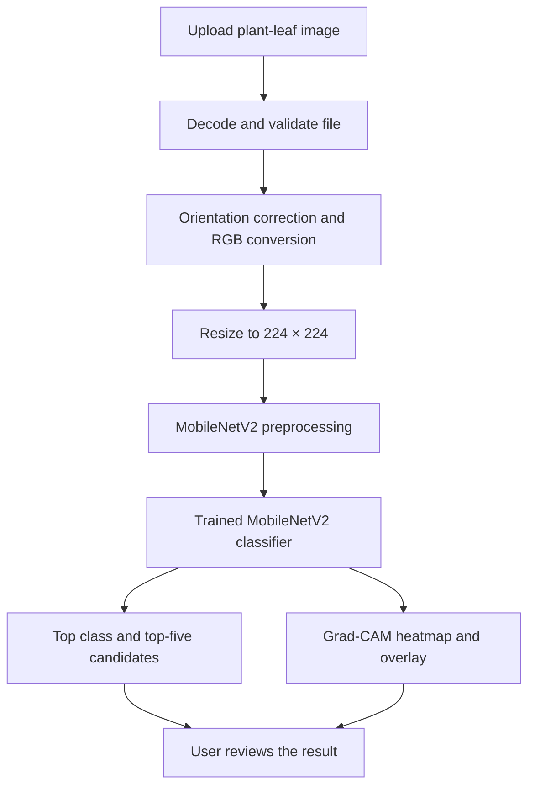

<div align="center">

# 🌿 Crop Disease Detection Using CNNs

### From leaf image to an explainable disease-classification result.

**Team AWX! · CodeSprint 2026**

[](https://www.python.org/)
[](https://www.tensorflow.org/)
[](https://streamlit.io/)
[](https://arxiv.org/abs/1801.04381)

> **A research and learning prototype for preliminary crop-leaf disease classification.**
> It is designed to support image-based screening—not to replace an agricultural expert.

**🚀 Live application:** Add your Streamlit Community Cloud URL here  
**📦 GitHub repository:** Add your repository URL here

</div>

---

## The idea

Crop diseases can affect plant health and agricultural productivity. This project explores how convolutional neural networks can help classify visible crop-leaf symptoms from an image.

The application uses a **MobileNetV2** model trained on the **PlantVillage** dataset. A user uploads a leaf image, reviews the leading predicted classes, and can inspect a **Grad-CAM** visualization to see image regions associated with the model's prediction.

The goal is to make an image-classification workflow easy to try, inspect, and reproduce.

## At a glance

| Project detail | Current implementation |
|---|---|
| Task | Multi-class crop-leaf image classification |
| Dataset | PlantVillage |
| Supported labels | 38 classes |
| Model family | MobileNetV2 with transfer learning |
| Selected app model | Color-image model |
| Input size | 224 × 224 pixels |
| User interface | Streamlit |
| Visual explanation | Grad-CAM heatmap and overlay |
| Training environment | TensorFlow/Keras, CPU experiment |
| App input handling | Image decoding, format and size checks, quality warnings, user confirmation |

## Try the application

The deployed Streamlit app is the easiest way to explore the project.

1. Open the live application using the link at the top of this README.
2. Upload a clear, well-lit plant-leaf image.
3. Confirm that the image shows a plant leaf.
4. Review the top predicted class and top-five alternatives.
5. Inspect the Grad-CAM overlay when it is available.

**Important input limitation:** the app does not contain an independently trained leaf/non-leaf detector. The confirmation checkbox is a user reminder, not automatic image recognition. A non-leaf photo can still receive one of the model's known class labels.

## What the application includes

- **Image upload:** accepts JPG, JPEG, PNG, BMP, WEBP, TIFF and GIF files.
- **Upload safeguards:** checks file contents, file size, dimensions and whether the image can be decoded; a misleading file extension does not make a corrupt image valid.
- **Image preparation:** applies orientation correction, RGB conversion, resizing and MobileNetV2 preprocessing.
- **Disease classification:** returns a predicted class from the 38 supported PlantVillage labels.
- **Top-five candidates:** displays the leading model outputs for comparison.
- **Grad-CAM:** provides a heatmap and overlay as a visual aid when the explanation helper works.
- **Error handling:** separates upload, inference and Grad-CAM errors so a visualization failure does not hide an otherwise successful prediction.
- **Quality and uncertainty warnings:** flags some obvious image-quality concerns and relatively low top scores.

## How it works



The leaf-confirmation step is manual. It must not be interpreted as automatic verification that an uploaded image contains a leaf.

## Model experiments

Three separate MobileNetV2 experiments were trained using the three PlantVillage image sections.

| Training image section | Test accuracy | Test images |
|---|---:|---:|
| **Color** | **94.09%** | 8,066 |
| Segmented | 91.99% | 8,225 |
| Grayscale | 90.07% | 8,066 |

The **color model** is used by the current Streamlit application because it achieved the highest recorded test accuracy among these experiments.

### Color model — recorded evaluation

| Metric | Result |
|---|---:|
| Test loss | 0.1791 |
| Test accuracy | 94.09% |
| Macro precision | 93.84% |
| Macro recall | 91.87% |
| Macro F1-score | 92.51% |
| Weighted F1-score | 94.06% |

The color model's saved split contained 37,996 training images, 8,243 validation images and 8,066 test images. Training used five epochs in the recorded CPU experiment.

**How to interpret these numbers:** these metrics describe performance on the project's PlantVillage test split. They are not a guarantee of accuracy on photographs taken in farms, under different lighting, against complex backgrounds, or at different disease stages. Model scores are not presented as calibrated probabilities.

## Dataset and EDA

The project uses three PlantVillage image sections:

- `color`
- `grayscale`
- `segmented`

The local dataset scan found:

| Section | Classes | Image files | Empty classes |
|---|---:|---:|---:|
| Color | 38 | 54,305 | 0 |
| Grayscale | 38 | 54,305 | 0 |
| Segmented | 38 | 54,306 | 0 |
| **Total across sections** | — | **162,916** | **0** |

The combined count represents files across three image representations; it should **not** be interpreted as 162,916 unique original photographs.

### EDA findings

- All three sections contained 38 class folders.
- No empty class folders were found.
- The color section ranged from 152 images in `Potato___healthy` to 5,507 in `Orange___Haunglongbing_(Citrus_greening)`.
- The largest class contained approximately 36.23 times as many images as the smallest class, indicating substantial class imbalance.
- A dimension sample of 1,140 images found 256 × 256 pixels for every sampled image.
- The sections had nearly identical class distributions, with a one-image count difference in the segmented section for one class.

These findings make per-class precision, recall, F1-score and confusion-matrix analysis important alongside overall accuracy.

## Technology stack

| Area | Tools |
|---|---|
| Programming language | Python 3.11 |
| Deep learning | TensorFlow 2.19 / Keras |
| CNN architecture | MobileNetV2 |
| Image handling | Pillow, NumPy |
| Data analysis | pandas, scikit-learn |
| Visualization | Matplotlib |
| Explainability | Grad-CAM |
| Web application | Streamlit |
| Version control | Git and GitHub |
| Deployment | Streamlit Community Cloud |

## Repository layout

The following shows the intended project organization. Keep the tree in sync with the files actually present in your repository.

```text
CNN-D/
├── data/
│   ├── raw/                         # Local PlantVillage data; do not commit by default
│   └── processed/
│       └── splits/                  # Train / validation / test CSVs
├── docs/                            # Problem statement, scope, report, user guide
├── models/
│   └── mobilenetv2_cpu/
│       ├── color/
│       │   ├── best_model.keras
│       │   ├── class_mapping.json
│       │   ├── classification_report.csv
│       │   ├── confusion_matrix.csv
│       │   └── metrics.json
│       ├── grayscale/
│       └── segmented/
├── reports/
│   ├── eda/
│   ├── gradcam/
│   └── ...                          # Dataset quality and model comparison reports
├── src/
│   ├── app.py
│   ├── dq.py
│   ├── dataset_prep.py
│   ├── eda.py
│   ├── cpu_trial.py
│   ├── train_mobilenetv2_cpu.py
│   └── gradcam.py
├── .gitignore
├── requirements.txt
└── README.md
```

## Run locally

### 1. Clone the repository

```bash
git clone <YOUR_GITHUB_REPOSITORY_URL>
cd CNN-D
```

### 2. Create and activate a virtual environment

**Windows PowerShell**

```powershell
python -m venv .venv
.\.venv\Scripts\Activate.ps1
```

If PowerShell prevents activation, use Command Prompt:

```bat
.venv\Scripts\activate.bat
```

### 3. Install dependencies

```bash
python -m pip install --upgrade pip
pip install -r requirements.txt
```

### 4. Verify required model assets

The app expects these files relative to the repository root:

```text
models/mobilenetv2_cpu/color/best_model.keras
models/mobilenetv2_cpu/color/class_mapping.json
```

The `gradcam.py` helper must also be present in `src/`.

### 5. Launch Streamlit

```bash
python -m streamlit run src/app.py
```

Open the local URL printed in the terminal (normally `http://localhost:8501`).

## Reproduce the workflow

The scripts are provided for the main project workflow. Run them from the repository root and inspect their path/configuration settings before execution.

| Stage | Script / location | Purpose |
|---|---|---|
| Dataset quality | `src/dq.py` | Inspect image counts, unreadable files and duplicate groups |
| Dataset preparation | `src/dataset_prep.py` | Prepare split CSVs |
| Exploratory analysis | `src/eda.py` | Generate class distribution and dataset overview reports |
| Model experiments | `src/train_mobilenetv2_cpu.py` | Train and compare the three image-section models |
| Explainability | `src/gradcam.py` | Generate Grad-CAM visualizations for a selected leaf image |
| Application | `src/app.py` | Run the Streamlit user interface |

Training can take substantial time and requires the dataset at the paths configured in the scripts. It is not necessary to retrain the models just to run the application.

## Project reports

Useful generated outputs include:

- `reports/eda/` — dataset summary, class distributions and EDA charts.
- `reports/gradcam/` — Grad-CAM heatmap and overlay.
- `reports/mobilenetv2_cpu_section_comparison.csv` — comparison of the three model experiments.
- `models/mobilenetv2_cpu/<section>/classification_report.csv` — per-class evaluation metrics.
- `models/mobilenetv2_cpu/<section>/confusion_matrix.csv` — class-level prediction counts.
- `models/mobilenetv2_cpu/<section>/metrics.json` — experiment summary.

File availability depends on which generated outputs are included in the published repository.

## Limitations and responsible use

- The classifier predicts among its 38 supported labels; it is not a general-purpose plant, crop or object recognizer.
- There is no trained automatic leaf/non-leaf detector. Manual confirmation does not verify image content.
- PlantVillage images are relatively controlled. Real field conditions can introduce different backgrounds, lighting, camera quality, leaf angles, crop varieties and symptom stages.
- A high model score is not proof of a correct diagnosis and should not be treated as a calibrated probability.
- Grad-CAM is an inspection aid, not proof that the model learned biologically valid features.
- This prototype should not be the sole basis for pesticide use, treatment selection or other consequential agricultural decisions. Consult a qualified agricultural professional.

## Future directions

Potential extensions include broader evaluation on independent field photographs, targeted work on weaker disease classes, improved uncertainty handling, experiment tracking, and usability testing with intended users.

## Data, model and licensing

The PlantVillage dataset and ImageNet-pretrained MobileNetV2 weights have their own usage and redistribution terms. Review the applicable licenses and conditions before redistributing data or weights. The repository's code license does not automatically apply to third-party datasets or pretrained weights.

Add a `LICENSE` file to this repository to define the license for your own code.

## Acknowledgements

- PlantVillage dataset contributors.
- TensorFlow and Keras.
- The MobileNetV2 authors and ImageNet pretrained-weight contributors.
- Streamlit and the open-source Python ecosystem.

---

<div align="center">

**Built by Team AWX! · CodeSprint 2026**

*Explore the image. Inspect the prediction. Validate before acting.*

</div>
